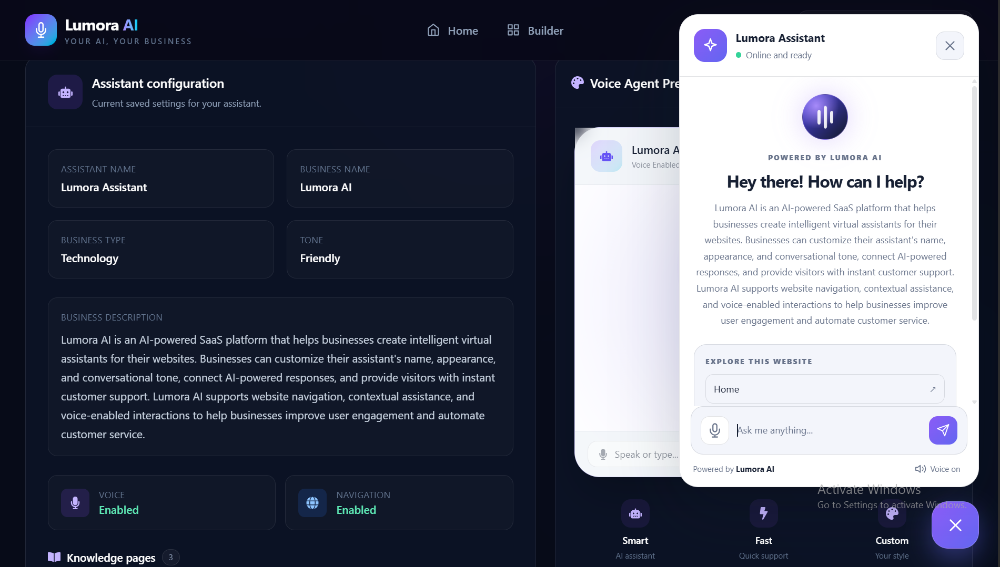
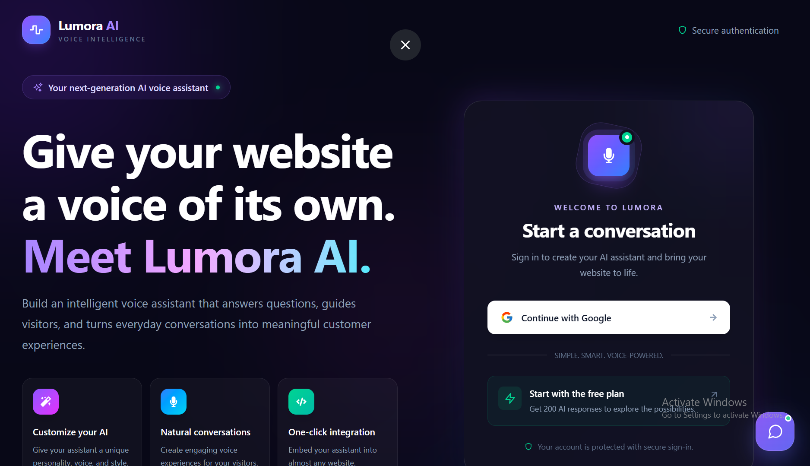
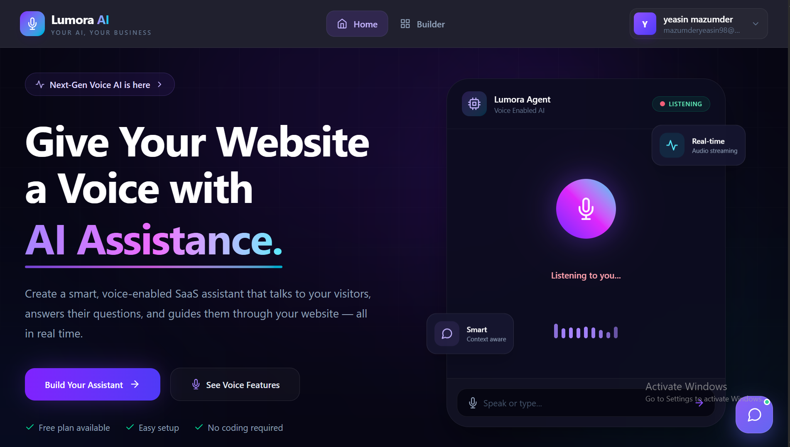
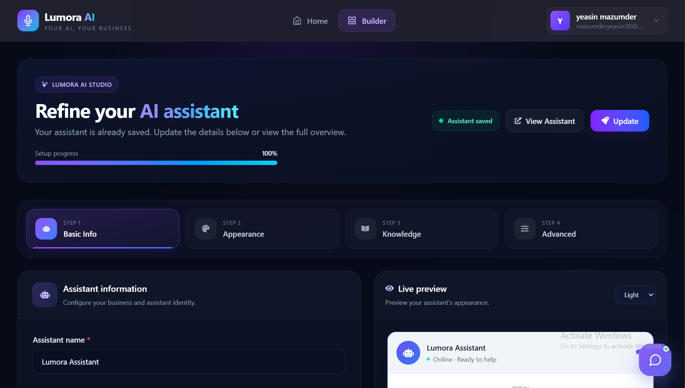
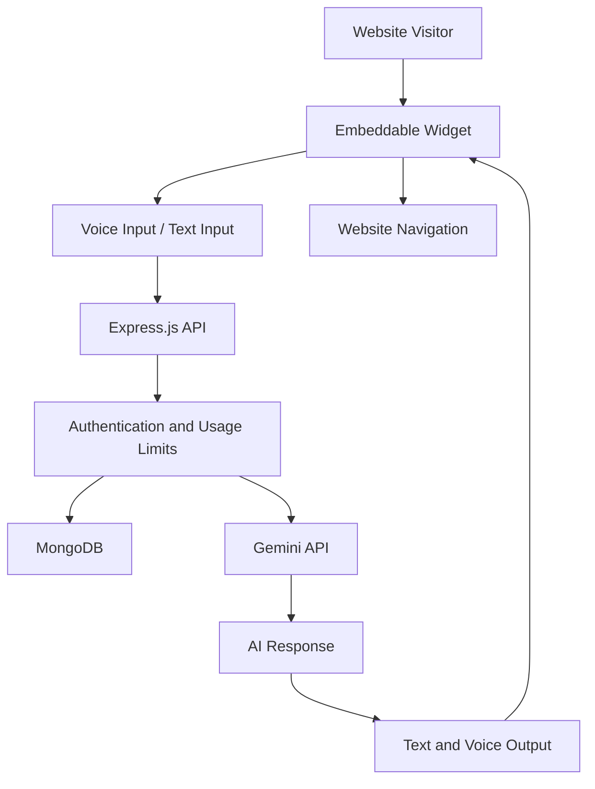

# ✨ Lumora AI — Embeddable AI Voice Agent

## 📸 Screenshots

### 🏠 Home Page


### 💬 AI Assistant Widget


### ⚙️ Settings Dashboard


### ⚙️ Settings Dashboard


<p align="center">
  <strong>A powerful, intelligent, and customizable AI voice assistant that you can embed into virtually any website.</strong>
</p>

<p align="center">
  Lumora AI transforms ordinary websites into interactive experiences with conversational AI, voice responses, intelligent customer support, and automatic website navigation.
</p>

---

## 🚀 Overview

**Lumora AI** is an AI-powered voice assistant built with the MERN stack and Google's Gemini API. It helps businesses interact with website visitors, answer questions, provide relevant information, and guide users to the right pages — all through a lightweight, embeddable widget.

Whether you're building a business website, launching an AI SaaS product, or developing a customer support platform, Lumora AI provides a foundation for delivering smarter and more engaging user experiences.

## ✨ Key Features

- 🗣️ **AI Voice Interaction** — Let visitors interact with your assistant using browser-based speech recognition and speech synthesis.
- 🤖 **Intelligent AI Responses** — Generate conversational answers using Google's Gemini API.
- 💬 **Smart Customer Support** — Answer visitor questions using business-specific information.
- 🏢 **Business-Aware Conversations** — Customize the assistant with business details, descriptions, and relevant website content.
- 🧭 **Automatic Website Navigation** — Help users find and navigate to relevant pages through natural-language requests.
- 🔌 **Embeddable Widget** — Integrate the assistant into supported websites with a simple script tag.
- 🎨 **Customizable Appearance** — Configure the assistant's name, tone, theme, and voice preferences.
- ⚙️ **Voice Settings** — Configure language preferences, voice selection, speech rate, pitch, and automatic speech.
- 🔐 **Authentication** — Support secure user authentication with token-based sessions and HTTP-only cookies.
- 📊 **Usage Tracking** — Track assistant usage and enforce configured request limits.
- 📱 **Responsive Interface** — Build an assistant experience designed to work across different screen sizes.

## 🛠️ Tech Stack

| Technology | Purpose |
|---|---|
| React.js | Interactive frontend |
| Tailwind CSS | Styling and responsive UI |
| Node.js | JavaScript runtime |
| Express.js | Backend API and server logic |
| MongoDB | Persistent data storage |
| Mongoose | MongoDB object modeling |
| Google Gemini API | AI-powered conversations |
| Web Speech API | Browser-based speech recognition and speech synthesis |
| JWT | Authentication tokens |
| HTTP-only Cookies | Authentication session storage |
| Vite | Frontend development and build tooling |

## 🏗️ Architecture



## 📂 Project Structure

```text
lumora-ai/
├── client/
│   ├── public/
│   │   ├── assistant.js
│   │   ├── assistant.css
│   │   └── assistant-widget.js
│   ├── src/
│   │   ├── components/
│   │   ├── pages/
│   │   ├── assets/
│   │   └── ...
│   ├── package.json
│   └── ...
│
├── server/
│   ├── Configs/
│   │   ├── db.js
│   │   ├── token.js
│   │   └── gemini.js
│   ├── Controllers/
│   ├── Models/
│   ├── Routes/
│   ├── Middleware/
│   ├── .env.example
│   ├── package.json
│   └── server.js
│
└── README.md
```

> **Note:** Adjust the folder and file names above to match your actual repository structure.

## ⚡ Getting Started

Follow these steps to run Lumora AI locally.

### Prerequisites

Make sure you have installed:

- [Node.js](https://nodejs.org/) — LTS version recommended
- [MongoDB](https://www.mongodb.com/) — Local installation or MongoDB Atlas
- [Google AI Studio API key](https://aistudio.google.com/) — For Gemini API access
- npm or another compatible package manager

### 1. Clone the Repository

```bash
git clone https://github.com/YOUR_USERNAME/lumora-ai.git
cd lumora-ai
```

Replace `YOUR_USERNAME` with your GitHub username and update the repository URL if necessary.

### 2. Install Dependencies

Install frontend dependencies:

```bash
cd client
npm install
```

Install backend dependencies:

```bash
cd ../server
npm install
```

### 3. Configure Environment Variables

Create a `.env` file inside the `server` directory:

```env
PORT=8000
NODE_ENV=development
MONGODB_URI=your_mongodb_connection_string
JWT_SECRET=your_strong_random_secret
GEMINI_API_KEY=your_gemini_api_key
CLIENT_URL=http://localhost:5173
```

Use the environment variable names expected by your actual application. If each user supplies their own Gemini API key, configure and securely store that key according to your implementation rather than assuming a global `GEMINI_API_KEY` is required.

**Security best practices:**

- Never commit `.env` files or API keys.
- Add `.env` to `.gitignore`.
- Keep Gemini API requests on the backend.
- Never log API keys, JWTs, or authentication cookies.
- Validate incoming requests and protect account-specific endpoints with authentication and authorization.

### 4. Start the Backend

```bash
cd server
npm run dev
```

The backend should be available at:

```text
http://localhost:8000
```

Use the start command defined in your `server/package.json` if it differs.

### 5. Start the Frontend

Open another terminal:

```bash
cd client
npm run dev
```

The frontend should be available at:

```text
http://localhost:5173
```

You can now open the frontend in your browser and test the application.

## 🔌 Embed Lumora AI Into Any Website

One of Lumora AI's core features is its embeddable assistant widget.

After deploying your widget assets and backend, add the following snippet to the website where you want the assistant to appear:

```html
<script
  src="https://YOUR_WIDGET_HOST/assistant.js"
  data-user-id="YOUR_ASSISTANT_USER_ID"
  async
></script>
```

Replace:

- `YOUR_WIDGET_HOST` with the public host serving your widget loader.
- `YOUR_ASSISTANT_USER_ID` with the appropriate assistant configuration ID.

For local development, if the widget loader is served from your Vite development server, the script URL can point to that server instead.

### How It Works

1. The host website loads `assistant.js`.
2. The loader reads the configured assistant ID from the script element.
3. The widget initializes on the host page.
4. Visitor messages are sent to the backend API.
5. The backend processes requests and obtains AI responses from Gemini.
6. The widget displays responses and can speak them using browser speech synthesis.
7. When enabled and configured, the assistant can guide visitors to relevant website pages.

**Important:** The assistant ID in an embed snippet is public. Do not use it as proof of authorization. Validate requests, apply rate limits, and protect administrative settings endpoints.

## 🗣️ Voice Capabilities

Lumora AI uses the browser's Web Speech API to support voice interactions.

| Capability | Description |
|---|---|
| Speech recognition | Converts supported spoken input into text |
| Speech synthesis | Reads AI responses aloud |
| Language preference | Allows supported language selection |
| Voice preference | Selects an available browser voice |
| Speech rate | Adjusts speaking speed |
| Pitch | Adjusts voice pitch |
| Automatic speech | Enables or disables spoken responses |

> Browser and operating-system support varies. Voice availability, recognition languages, and permissions depend on the visitor's environment. Some speech-recognition implementations may require an internet connection.

## 🧠 AI and Business Context

Configure the assistant to reflect the needs of a particular business.

Depending on your implementation, configuration can include:

- Assistant name and conversational tone
- Business name and description
- Frequently asked questions and relevant information
- Website page names, paths, and keywords
- Website navigation preferences
- Voice and appearance settings
- Usage limits and subscription information

For reliable business answers, provide accurate, current context and validate that the assistant's responses match your intended customer-support experience.

## 🔐 Security Considerations

Before deploying Lumora AI to production:

- Use HTTPS for your frontend, API, and widget assets.
- Store secrets in environment variables or a managed secrets service.
- Use secure cookie settings and appropriate CSRF protections.
- Configure CORS to allow only trusted origins where practical.
- Add API rate limiting and request validation.
- Enforce ownership checks on private settings and administrative routes.
- Apply appropriate usage limits to prevent unexpected API costs.
- Handle upstream Gemini errors, quota exhaustion, and retries gracefully.
- Avoid exposing private business information or API credentials through public widget responses.

## 🚀 Deployment

You can deploy the frontend, backend, database, and widget assets using services suited to your application.

| Component | Example options |
|---|---|
| React frontend | Vercel, Netlify |
| Express backend | Render, Railway, a VPS, or a cloud platform |
| MongoDB | MongoDB Atlas |
| Widget assets | A public frontend host or static asset hosting service |
| AI provider | Google Gemini API |

Before deployment, update the widget loader to use your production API URL, configure production CORS and HTTPS, and verify that the widget assets are publicly accessible.

## 🎯 Use Cases

Lumora AI can serve as a starting point for:

- ✅ AI SaaS products
- ✅ Customer support systems
- ✅ Business websites
- ✅ E-commerce assistance
- ✅ Portfolio projects
- ✅ Freelancing projects
- ✅ Startup prototypes
- ✅ Interactive website guides

## 🛣️ Roadmap

Potential future improvements include:

- [ ] Retrieval-Augmented Generation (RAG) for larger business knowledge bases
- [ ] Website content ingestion and indexing
- [ ] Conversation history and analytics dashboard
- [ ] Multilingual voice improvements
- [ ] Human-agent handoff
- [ ] More granular usage analytics
- [ ] Subscription and billing integration
- [ ] Advanced widget customization
- [ ] Automated evaluation of answer quality
- [ ] Production monitoring and observability

## 🤝 Contributing

Contributions, suggestions, and bug reports are welcome!

1. Fork the repository.
2. Create a feature branch.
3. Commit your changes.
4. Push your branch.
5. Open a pull request describing your improvements.

For larger changes, consider opening an issue first to discuss the proposed implementation.

## 🐛 Issues and Feedback

Found a bug or have an idea for a new feature? Open an issue in the repository with steps to reproduce the problem, relevant logs, and your expected behavior. Never include API keys, passwords, or other secrets in issue reports.

## 📄 License

This project is licensed under the MIT License, provided a `LICENSE` file is included in the repository. Add that file and update this section if you choose a different license.

## ⭐ Support the Project

If you find Lumora AI useful, consider giving the repository a star ⭐

Your feedback and contributions help make the project better.

---

<p align="center">
  <strong>Built with ❤️ using the MERN Stack and Gemini AI.</strong>
</p>

<p align="center">
  <sub>Making websites smarter, one conversation at a time.</sub>
</p>